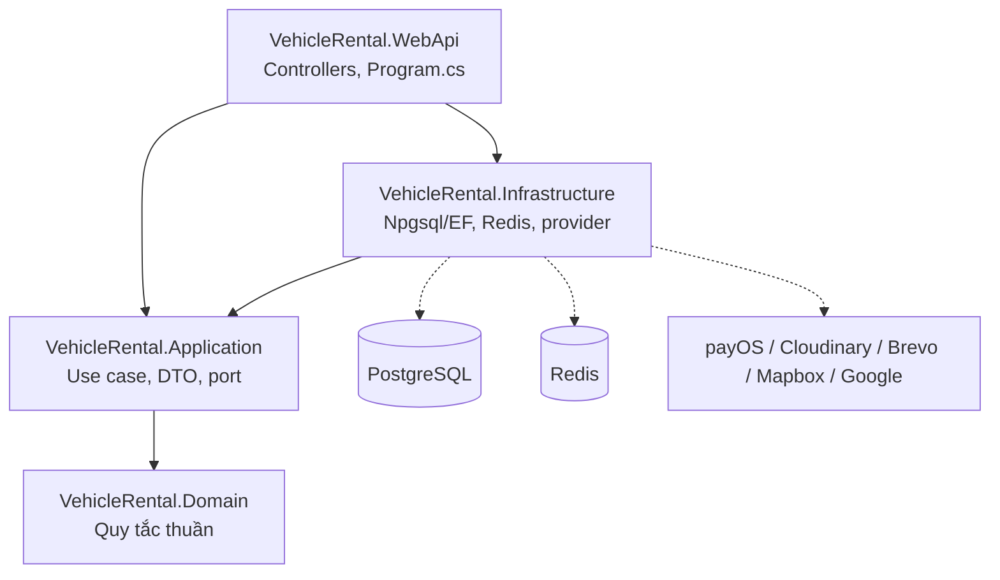
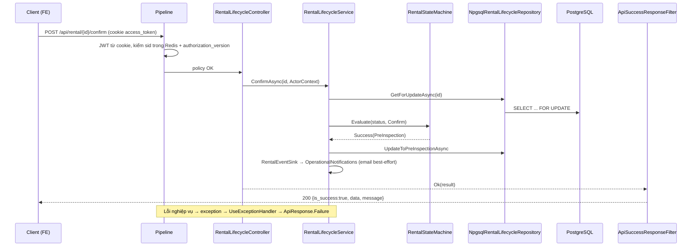
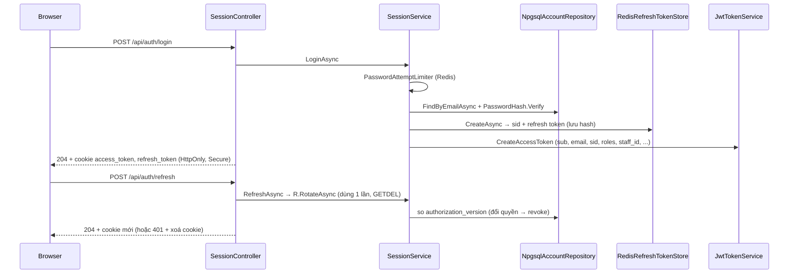
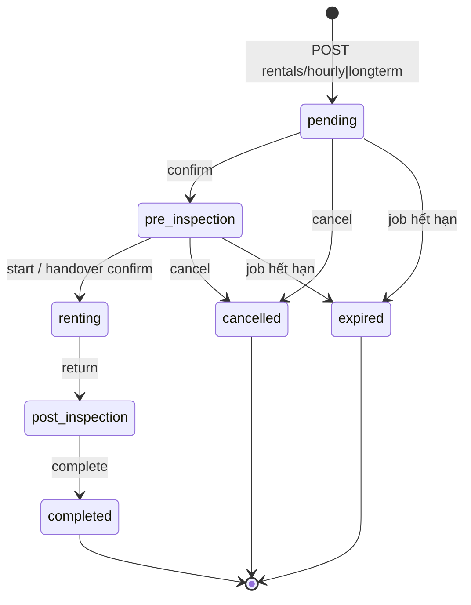

# Luồng hoạt động Backend

Tài liệu mô tả cách BE chạy end-to-end: từ lúc khởi động, một request đi qua các tầng thế nào, cho tới các luồng nghiệp vụ chính. Cấu trúc thư mục xem [architecture.md](architecture.md), chi tiết endpoint xem [API.md](API.md).

## 1. Kiến trúc tổng quan



| Layer | Vai trò | Ví dụ |
|---|---|---|
| Domain | Quy tắc nghiệp vụ thuần, không phụ thuộc gì | `RentalStateMachine`, `CancellationPolicy`, `OvertimeCalculator`, `SettlementCalculator`, `BookingStatusRules`, `TimeRange`, `LoyaltyDomainRules` |
| Application | Điều phối use case, định nghĩa port (interface) | `RentalLifecycleService`, `AssignmentService`, `PaymentService`, `SessionService`, `Interfaces/*` |
| Infrastructure | Hiện thực port | `Npgsql*Repository`, `VehicleRentalDbContext`, `RedisRefreshTokenStore`, `PayOsPaymentGateway`, `CloudinaryImageStorage`, `BrevoEmailSender`, `MapboxClient` |
| WebApi | Host, DI, HTTP | `Program.cs`, `Features/<Module>/*Controller`, `Common/Responses/*`, `Common/Authentication/*` |

Persistence: repository nhận `NpgsqlDataSource` (singleton). Mỗi method tự tạo `VehicleRentalDbContext.Create(...)`, đọc bằng LINQ no-tracking. Ghi và kiểm tra trong transaction thì dùng SQL thuần (`FOR UPDATE`, `pg_advisory_xact_lock`). Schema không dùng EF Migrations: `DatabaseMigrationHostedService` chạy các script trong `db/migrations` và lưu checksum.

## 2. Khởi động và request pipeline

**Khởi động (`Program.cs`)**

1. Đăng ký controller kèm global filter `ApiSuccessResponseFilter`, CORS cho FE (có credentials), Swagger.
2. Bind và validate options lúc khởi động (`ValidateOnStart`): Registration, Availability, Brevo, Tokens, Jwt, GoogleAuthentication, Mapbox, Loyalty.
3. Đăng ký `NpgsqlDataSource`, `IConnectionMultiplexer` (Redis) và typed `HttpClient` cho payOS, Brevo, Mapbox.
4. Đăng ký repository và service (scoped). `JwtTokenService` và `RedisRefreshTokenStore` là singleton.
5. Đăng ký các hosted service (mục 5).

**Thứ tự middleware**

```text
UseForwardedHeaders → UseApiResponseErrors (ExceptionHandler + StatusCodePages)
→ Swagger (ngoài Production) → HttpsRedirection → CORS → RateLimiter
→ Authentication (JWT từ cookie) → Authorization → MapControllers, /health
```

**Cách map lỗi** (`ApiResponseHttpExtensions`):

| Exception | HTTP status |
|---|---|
| `BusinessRuleException` | `StatusCode` của chính exception (`ConflictException` 409, `NotFoundException` 404) |
| `UnauthorizedAccessException` | 403 |
| `KeyNotFoundException` | 404 |
| `ArgumentException` / `InvalidOperationException` | 400 |
| Còn lại | 500 |

Mọi response đều dùng envelope `{code, status, is_success, data, message, error}` (`ApiResponse`).



## 3. Xác thực và phân quyền

**Đăng ký** (`AccountController`, rate limit `authentication`)

1. `POST api/account/registrations`: `RegistrationService` sinh OTP 6 số. Thông tin chờ xác thực (password và OTP đã hash) được lưu vào Redis kèm TTL, qua `IWorkflowStateStore`. OTP gửi bằng `BrevoEmailSender`.
2. `POST .../registrations/verify`: so OTP bằng fixed-time compare, xoá key bằng compare-exchange, rồi `IUserRepository.CreateCustomerAsync`.

Quên mật khẩu (`password-resets`) và đổi mật khẩu (`password/otp`, `password`) đi theo cùng mô hình OTP.

**Đăng nhập** (`SessionController`, `api/auth`)



- Thời hạn token: access 15 phút; refresh 7 ngày, hoặc 30 ngày nếu chọn "remember me".
- SameSite của cookie: request cross-site (có `Origin`) dùng `None`, còn lại dùng `Lax`.
- Đăng nhập Google: gọi `GET api/auth/google`, Google redirect về callback. Tại đó `OnCreatingTicket` gọi `UserService.EnsureGoogleCustomerAsync`, sau đó `GET api/auth/google/complete` ghi cookie và redirect về FE.
- Policy định nghĩa trong `AuthorizationPolicies`: Admin, Customer, Management, CustomerService, Inspection, Maintenance, DriverSchedule, RentalRead, FinancialRead.

## 4. Luồng nghiệp vụ

### 4.1 Tạo đơn thuê

Gọi `POST api/rentals/hourly` hoặc `POST api/rentals/longterm` (`OperationsController`, policy Customer).

1. `OperationsService.CreateRentalAsync` kiểm tra `paymentMethod` (`payos`/`cash`) và quy tắc FR-042 (thời gian đặt trước tối thiểu, tính `expire_at`).
2. `NpgsqlOperationsRepository.CreateRentalAsync` chạy trong một transaction:
   - `VehicleLock` khoá xe;
   - kiểm tra subscription, hoặc GPLX nếu khách tự lái;
   - kiểm tra xe còn trống (`VehicleAvailabilityChecks`);
   - tính VAT và tiền cọc theo `rental_policies`;
   - INSERT `rentals` (`pending`), chi tiết hourly/longterm và `invoices`.

### 4.2 Vòng đời rental

`RentalLifecycleController` gọi `RentalLifecycleService`. Mọi chuyển trạng thái đều đi qua `RentalStateMachine.Evaluate`. Chuyển trạng thái không hợp lệ trả 409 `ILLEGAL_TRANSITION`; gọi lại khi đơn đã ở trạng thái đích trả 409 `ALREADY_IN_STATE`.



| Endpoint `/api/rental/{id}/…` | Điều kiện chính |
|---|---|
| `confirm` | Nhân viên duyệt. Admin cũng có thể duyệt qua `inspection-assignment/checked?approveRequest` |
| `start` | Bắt buộc có pre-inspection đạt. Đơn longterm phải có hợp đồng đã ký. Đơn có tài xế phải có assignment hợp lệ; đơn tự lái phải có GPLX hợp lệ. Đơn trả trực tiếp (không dùng subscription) phải đã thanh toán |
| `return` | `returnedAt` nằm trong khoảng [start, now + 5 phút] |
| `complete` | Bắt buộc có post-inspection. Phí quá giờ (`OvertimeCalculator`) được trừ vào cọc (`SettlementCalculator`). Thiếu tiền thì tạo hoá đơn bù hoặc trừ giờ subscription; dư thì tạo refund. Cuối cùng cộng điểm loyalty |
| `cancel`, `cancellation-preview` | `CancellationPolicy` tính phí huỷ, sau đó void hoá đơn hoặc tạo refund |

Sau mỗi lần chuyển trạng thái, `RentalEventSink` gửi email thông báo (best-effort: lỗi email không làm hỏng request).

Các controller liên quan:
- Truy vấn đơn: `RentalQueriesController` (`/api/rentals/mine`, `/api/rentals`, `/overdue`, `/api/rental/{id}/detail`).
- Sửa đơn: `RentalEditingController`.

### 4.3 Xe trống, phân công, bàn giao, kiểm tra xe

**Tìm xe** (`VehicleSearchController` → `VehicleSearchService`)
- Endpoint: `GET api/vehicles/search`, `vehicle/{id}/availability`, `busy-slots`.
- `VehicleAvailabilityChecks` trả về một trong các kết quả: `NotFound`, `Maintenance`, `Inactive`, `Booked` (trùng lịch với đơn pending → post_inspection, có tính buffer), hoặc trùng lịch bảo trì.
- Có rate limit `public-search`.

**Phân công** (`RentalAssignmentsController` → `AssignmentService` → `NpgsqlAssignmentRepository`)
- Gán tài xế: lần gán đầu cần pre-inspection đạt và tài xế phải nằm trong danh sách ứng viên. Đơn tự lái không được gán tài xế. `DriverLock` chống gán trùng khi có request đồng thời.
- Đổi xe: xe mới phải cùng loại, đang active và còn trống trong khung giờ.

**Sự cố và ca trực** (`DispatchController` → `IOperationsService`): báo cáo sự cố, xe thay thế, ca tài xế.

**Bàn giao** (`HandoversController` → `HandoverService`): `POST api/handover/{rentalId}/confirm` ủy quyền sang `RentalLifecycleService.StartAsync`.

**Kiểm tra xe**
- Ghi biên bản: `POST rental/{id}/inspections/pre|post` (`OperationsController`, policy Inspection).
- Phân công kỹ thuật viên: `InspectionAssignmentsController`.
- Tra cứu: `GET api/inspections`.
- Ảnh biên bản: `POST api/media/inspection`.

### 4.4 Thanh toán (payOS)

Luồng gọi: `PaymentsController` → `PaymentService` → `NpgsqlPaymentRepository` + `PayOsPaymentGateway`.

```mermaid
sequenceDiagram
    participant FE
    participant PC as PaymentsController
    participant PS as PaymentService
    participant Repo as NpgsqlPaymentRepository
    participant GW as PayOsPaymentGateway
    participant P as payOS
    FE->>PC: POST invoice/{id}/checkout
    PC->>PS: checkout
    PS->>Repo: ReserveInvoiceCheckoutAsync (chỉ invoice unpaid)
    PS->>GW: CreateCheckoutAsync (ký HMAC)
    GW->>P: POST v2/payment-requests
    PC-->>FE: checkoutUrl
    P->>PC: POST api/payments/webhooks/payos
    PC->>PS: HandleWebhookAsync
    PS->>GW: VerifyWebhook (sai chữ ký → 400)
    PS->>Repo: CompleteInvoiceAsync / CompletePlanPurchaseAsync
    Note over Repo: FOR UPDATE rental, chống trùng provider_reference,<br/>INSERT payments, invoices=paid, rental_orders;<br/>rental đã expired → tạo refund requested
```

Các thao tác khác:
- Mua gói: `subscription-plan/{planId}/purchase`.
- Huỷ checkout: `payments/checkout/{orderCode}/cancel` (tra lại payOS trước khi huỷ).
- Tiền mặt: `invoice/{id}/cash-confirmation`.
- Phí quá giờ do nhân viên thu: `staff-checkout`.
- Hoàn tiền: `payment/{id}/refunds`, `payments/refund/{id}/approve|reject`.

### 4.5 Khách hàng thân thiết

Luồng gọi: `LoyaltyController` → `LoyaltyService` → `NpgsqlLoyaltyRepository`.

| Hạng | Ngưỡng điểm | Hệ số |
|---|---|---|
| Member | 0 | ×1.00 |
| Silver | 500 | ×1.10 |
| Gold | 2000 | ×1.25 |
| Platinum | 5000 | ×1.50 |

- Cộng điểm chỉ xảy ra khi `complete` một đơn không dùng subscription. Điểm tính trên basis = total − VAT − cọc. Lỗi khi cộng điểm chỉ được log, không làm hỏng việc hoàn tất đơn.
- Endpoint cho khách: `api/loyalty/me`, `me/transactions`, `redemption-quote`.
- Endpoint cho quản lý: điều chỉnh điểm, đối soát.

## 5. Background job và tích hợp ngoài

| Thành phần | Mô tả |
|---|---|
| `HostedServices/DatabaseMigrationHostedService` | Chạy migration SQL lúc khởi động, kiểm checksum |
| `HostedServices/RedisConnectionHostedService` | Ping Redis lúc khởi động |
| `HostedServices/RentalExpiryHostedService` | Mỗi 1 phút: `RentalExpiryService.ExpireDueAsync` (FR-042) |
| `HostedServices/SubscriptionExpiryHostedService` | Mỗi 6 giờ: hết hạn subscription, gửi nhắc |
| `HostedServices/TelemetryRetentionHostedService` | Định kỳ xoá vị trí GPS cũ |
| payOS | Checkout, tra trạng thái, verify webhook |
| Cloudinary | Ảnh avatar, xe, GPLX, biên bản, sự cố (`MediaService`) |
| Brevo | Email OTP và thông báo vận hành |
| Redis | Refresh token, trạng thái OTP, bộ đếm đăng nhập sai |
| Mapbox | `api/map`: geocode, places, directions, distance matrix |
| Google OAuth | `ExternalAuthController` |

## 6. Bảng ánh xạ Controller → Service → Repository

| Controller | Service | Repository / adapter |
|---|---|---|
| AccountController | RegistrationService, PasswordResetService, PasswordChangeService, AccountService | NpgsqlUserRepository, NpgsqlAccountRepository, RedisWorkflowStateStore |
| SessionController, ExternalAuthController | SessionService | NpgsqlAccountRepository, RedisRefreshTokenStore, JwtTokenService |
| UsersController | UserAdministrationService | NpgsqlUserAdministrationRepository |
| RolesController | RoleService | NpgsqlRoleRepository |
| AuditLogsController | AuditLogService | NpgsqlAuditLogRepository |
| CustomersController | CustomerService | NpgsqlCustomerRepository |
| StaffController, DepartmentMembersController, FacilityMembersController | StaffService | NpgsqlStaffRepository |
| DashboardController | DashboardService | NpgsqlDashboardRepository |
| NavigationCountsController | NavigationCountsService | NpgsqlNavigationCountsRepository |
| OperationsController, DispatchController | OperationsService, OperationsCompletionService | NpgsqlOperationsRepository (partial), NpgsqlOperationsCompletionRepository |
| RentalLifecycleController | RentalLifecycleService | NpgsqlRentalLifecycleRepository + adapter payment/invoice/subscription/loyalty |
| RentalQueriesController | RentalQueryService | NpgsqlRentalQueries |
| RentalEditingController | RentalEditingService | NpgsqlOperationsRepository (IRentalEditingRepository) |
| RentalContractDocumentsController | RentalContractDocumentService | NpgsqlRentalContractDocumentRepository |
| HandoversController | HandoverService | IRentalQueries + IRentalLifecycleService |
| RentalAssignmentsController | AssignmentService | NpgsqlAssignmentRepository, NpgsqlVehicleAvailabilityService |
| VehicleSearchController | VehicleSearchService | NpgsqlVehicleSearchRepository, NpgsqlVehicleAvailabilityService, NpgsqlDriverAvailability |
| InspectionAssignmentsController | InspectionAssignmentService | NpgsqlInspectionAssignmentRepository |
| InspectionsController | InspectionDirectoryService | NpgsqlInspectionDirectoryRepository |
| PaymentsController | PaymentService | NpgsqlPaymentRepository, PayOsPaymentGateway |
| LoyaltyController | LoyaltyService | NpgsqlLoyaltyRepository |
| MediaController | MediaService | CloudinaryImageStorage, NpgsqlUserRepository |
| TrackingController, DevicesController, GeofencesController | TrackingService | NpgsqlTrackingRepository |
| MapController | MapService | MapboxClient |
